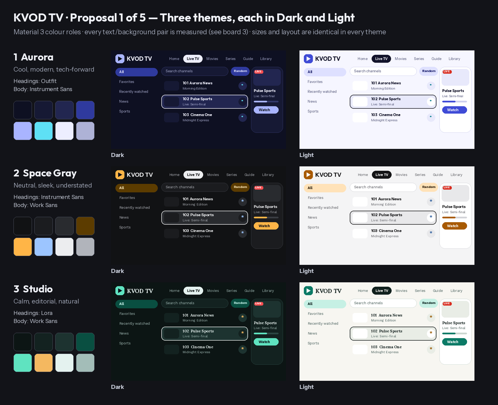

# Themes and fonts

KVOD TV ships **three themes**, each in a **dark** and a **light** variant (Settings > Appearance > Theme, plus *Dark / Light / Follow system*).
Colours follow Material 3 roles (background, surface, surface-container, primary, primary-container, tertiary, outline, error). Body text on
backgrounds and cards is at least 7:1 (AAA), secondary text at least 4.5:1 and accents at least 3:1; `SubtitleAndThemeTest` enforces this for every variant.

| Theme | Fonts | Dark: background / primary | Light: background / primary |
|---|---|---|---|
| Aurora | Outfit headings, Instrument Sans body | #0E1022 / #A9B4FF | #F6F6FF / #3F4BD6 |
| Space Gray | Instrument Sans headings, Work Sans body | #111214 / #FFB547 | #F4F4F5 / #A85A00 |
| Studio | Lora (serif) headings, Work Sans body | #0C1514 / #5FE3C0 | #F7F6F1 / #0B7A66 |

Design boards (themes, typography, colour pairs, subtitle presets, logo directions) are in `docs/design/`.

Sizes, weights and spacing are identical in every theme (see `TYPOGRAPHY.md`); only the font family and colours change, so layouts never shift when
the theme changes. An optional *Accent colour* in Settings can replace the theme's primary colour.

## Bundled fonts (SIL Open Font License 1.1)
Outfit, Work Sans, Instrument Sans and Lora are bundled as static TTF files in `app/src/main/res/font/` (regular + bold). Licence texts: `app/src/main/assets/licenses/fonts/`.
Downloadable Google Fonts were **not** used because Fire OS has no Google Play services. Glyphs missing from these fonts (for example Hindi) fall back to the system font.

## Where it lives in code
`core/ui/Theme.kt` (`tonesFor`, `IptvTheme`, `AppFonts`, `tvTypography`), `core/model/Models.kt` (`AppTheme`, `ThemeMode`, `AccentColor`), gallery in `feature/settings/SettingsScreen.kt`.
Names saved by earlier builds (MIDNIGHT, EMBER, ORCHID, FOREST, OCEAN, GRAPHITE, MATERIAL_DARK, MATERIAL_GRAY, LIGHT) are mapped to a theme + mode by `AppTheme.fromStored`.
